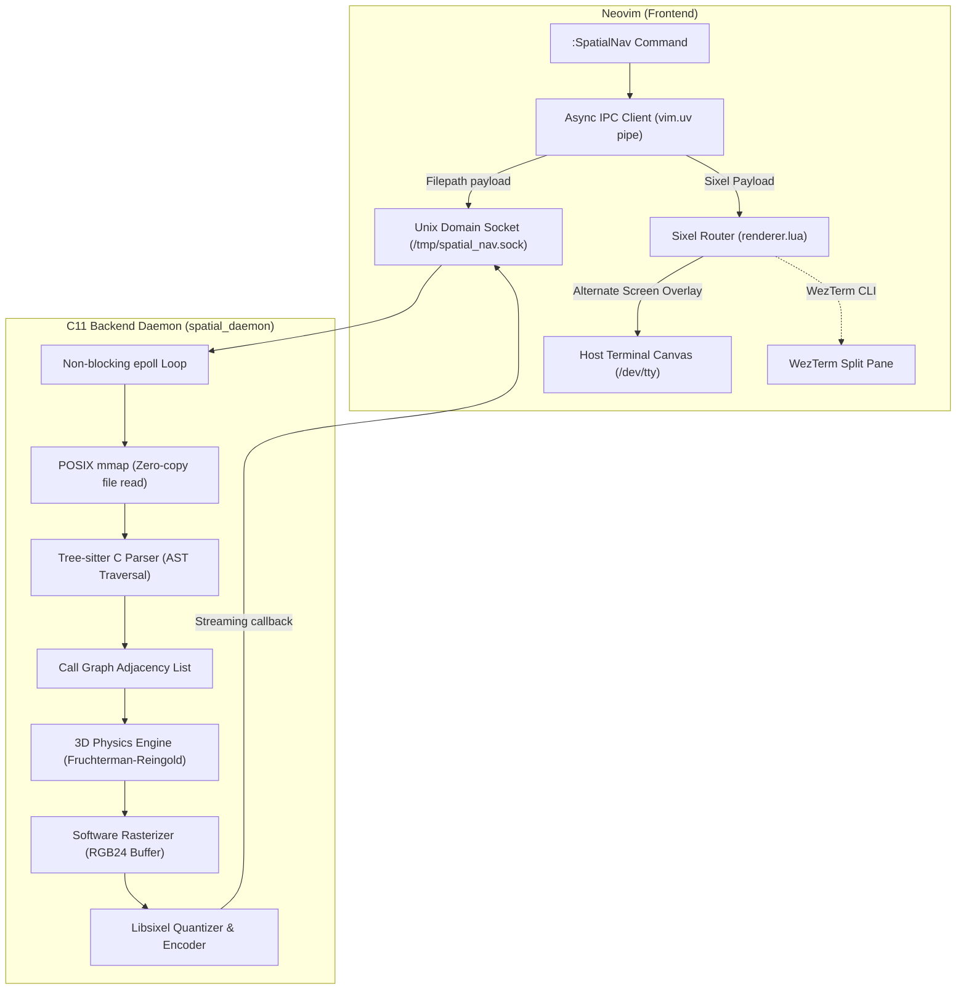

# Spatial Codebase Navigator

A low-level, high-performance 3D spatial codebase visualizer for C projects and Neovim. Built with zero high-level graphics abstractions—powered by strict C11, Tree-sitter AST parsing, custom Fruchterman-Reingold 3D physics, an in-memory software rasterizer, DEC SIXEL terminal graphics, and asynchronous Neovim IPC via `vim.uv`.

---

## Architecture Overview



---

## Features

- **Strict C11 / POSIX Backend**: Zero memory leaks, verified under AddressSanitizer and UndefinedBehaviorSanitizer under heavy concurrent stress.
- **Tree-sitter AST Traversal**: Uses `tree-sitter-c` over `mmap`'ed source buffers to extract function definitions, byte-volume heuristics, and call expressions.
- **Custom 3D Physics Simulation**: $O(N^2)$ Fruchterman-Reingold force-directed layout in 3D Euclidean space with Coulomb repulsion, Hooke spring attraction, cooling schedules, and centroid normalization.
- **Software Rasterizer**: Pure C 3D-to-2D perspective camera projection ($F=600$, $Z_{\text{cam}}=350$) with near-plane clipping, Painter's algorithm depth sorting, directional light-shaded spherical discs, and integer Bresenham edge lines.
- **DEC SIXEL IPC Streaming**: In-memory frame quantization into 256-color DEC palettes via `libsixel`, streamed asynchronously across non-blocking Unix Domain Sockets with `poll(POLLOUT)` flow control.
- **Direct Terminal Rendering**: Bypasses Neovim's internal `libvterm` by routing Sixel graphics directly to the host terminal canvas via `/dev/tty` alternate-screen modal overlay or native WezTerm split pane. Zero external runtime dependencies.

---

## Prerequisites

- **OS**: Linux or WSL2 (POSIX environment)
- **Compiler**: GCC 10+ or Clang with C11 support
- **Build System**: CMake 3.16+
- **Libraries**:
  - `libtree-sitter` & `tree-sitter-c-src` (or precompiled parser)
  - `libsixel` (`libsixel-dev`)
  - `pthread` & `libm`
- **Editor**: Neovim 0.10+
- **Terminal**: Any terminal emulator with SIXEL support (e.g. WezTerm, Foot, Alacritty with Sixel patch, iTerm2, Windows Terminal Preview).

On Debian / Ubuntu:
```bash
sudo apt update
sudo apt install -y build-essential cmake libtree-sitter-dev tree-sitter-c-src libsixel-dev python3 neovim
```

---

## Quickstart

### 1. Build and Run the C Daemon

```bash
# Clone the repository
git clone https://github.com/IvanGiovany/spatial-navigator.git
cd spatial-navigator

# Configure and compile daemon and test binaries
cmake -B daemon/build -S daemon
cmake --build daemon/build

# Start the daemon
./daemon/build/spatial_daemon
```
The daemon binds to `/tmp/spatial_nav.sock` and listens asynchronously using `epoll`.

### 2. Configure the Neovim Plugin

Add `spatial-navigator` to your Neovim plugin manager or runtimepath.

#### Using `lazy.nvim`:
```lua
{
  "IvanGiovany/spatial-navigator",
  opts = {
    socket_path = "/tmp/spatial_nav.sock",
    width_ratio = 0.85,
    height_ratio = 0.85,
    border = "rounded",
  },
}
```

#### Manual runtimepath:
```lua
vim.opt.runtimepath:append("/path/to/spatial-navigator/nvim-plugin")
require("spatial_nav").setup()
```

### 3. Usage in Neovim

Open any C source file in Neovim and run:
```vim
:SpatialNav
```
Or visualize any arbitrary C file:
```vim
:SpatialNav /path/to/project/main.c
```

#### Floating Window Controls:
- `q`, `<Esc>`, or `<C-c>`: Close the 3D visualization window and cancel any active socket streams.

---

## Automated Verification Suite

Run the master test runner from the repository root:
```bash
./test_all.sh
```

The test runner automatically validates:
1. **Compilation**: All targets (`spatial_daemon`, `test_parser`, `test_physics`, `test_raster`).
2. **Unit Tests**:
   - `test_parser`: AST extraction, call graph resolution, edge cases (empty files, nonexistent files).
   - `test_physics`: Repulsion, attraction, equilibrium rest distance ($k=50$), centroid normalization.
   - `test_raster`: Perspective camera projection math, frame buffer rasterization, libsixel DCS format.
3. **Neovim Plugin Tests**: Headless Neovim (`nvim --headless`) verifying UI window geometry, terminal lifecycle, and offline socket error handling.
4. **Live IPC & SIXEL Streaming**: End-to-end communication from daemon to Neovim terminal stream.
5. **Concurrency & Memory Leak Profiling**: 50 concurrent requests across 10 worker threads against an AddressSanitizer/UndefinedBehaviorSanitizer instrumented daemon. Clean shutdown and socket unlink verified.

---

## Project Structure

```
spatial-navigator/
├── daemon/
│   ├── CMakeLists.txt         # C11 build configuration & dependency discovery
│   ├── src/
│   │   ├── main.c             # Unix domain socket server & epoll event loop
│   │   ├── parser.c/h         # Zero-copy mmap & Tree-sitter AST extraction
│   │   ├── graph.c/h          # Graph structures & Fruchterman-Reingold 3D simulation
│   │   └── render.c/h         # Perspective projection, software rasterizer, libsixel
│   └── tests/
│       ├── sample_project.c   # Sample C project with known function call hierarchy
│       ├── test_parser.c      # Unit tests for AST parser & graph construction
│       ├── test_physics.c     # Unit tests for 3D physical force equilibrium
│       ├── test_raster.c      # Unit tests for perspective rasterizer & sixel stream
│       └── stress_test.py     # 50-client concurrency stress test
├── nvim-plugin/
│   ├── plugin/
│   │   └── spatial_nav.lua    # Global user command registration (:SpatialNav)
│   ├── lua/
│   │   └── spatial_nav/
│   │       ├── init.lua       # Plugin entry point & configuration setup
│   │       ├── ui.lua         # Floating window, nvim_open_term, keybindings
│   │       └── ipc.lua        # vim.uv async pipe client & Sixel stream playback
│   └── tests/
│       └── test_plugin.lua    # Headless Neovim test suite
├── test_all.sh                # Master CI verification & ASan stress runner
└── gemini_cli_master_plan.md  # Architectural roadmap and specifications
```

---

## License

MIT License.
